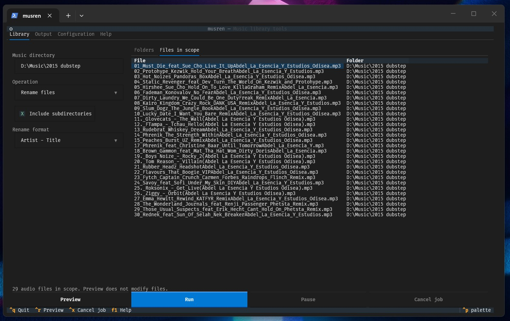

# musren

[](https://github.com/coslatte/musren/releases)
[](https://github.com/coslatte/musren/actions/workflows/ci.yml)
[](pyproject.toml)
[](LICENSE)

Organize a local music library from a desktop app, a terminal interface, or a
CLI. musren renames audio files from their metadata, embeds synchronized lyrics
and album artwork, recognizes unidentified tracks, and groups albums into
folders. Everything runs on your machine; only lyrics, artwork, and recognition
contact remote services.



## Features

- **Rename** files from artist, title, and optional album track numbers.
- **Embed lyrics** from synced lyrics providers.
- **Embed covers** from MusicBrainz and the Cover Art Archive, skipping existing
  artwork.
- **Recognize** tracks with AcoustID or Shazam and write the identified metadata.
- **Group albums** into folders with a `Singles` folder for loose tracks, and
  revert the grouping later.
- **Preview and confirm** every operation, with per-file progress and errors, and
  keep or undo the renames after a run.
- **Three interfaces** on one shared engine: Tauri desktop app, Textual TUI, and
  a Typer CLI.
- **Local history** and credentials stored in the OS credential store.
- **Themes**: Kanagawa Lotus (light) and Wave (dark), or follow the system theme.

## Install

Download the package for your platform from the
[latest release](https://github.com/coslatte/musren/releases/latest). Release
packages and checksums are listed on the
[releases page](https://github.com/coslatte/musren/releases).

### Windows

- **Desktop app**: run the signed NSIS installer (Windows 10 or newer).
- **Portable TUI and CLI**: download
  [`musren-windows-x64.exe`](https://github.com/coslatte/musren/releases/latest/download/musren-windows-x64.exe)
  and double-click it. Python and the optional Python dependencies are bundled;
  no installer is required.

CI artifacts without a signature are for validation only. Use the signed files
attached to a release.

### macOS

Download the DMG for Apple Silicon or Intel (macOS 11 or newer), open it, and
drag musren into Applications.

### Arch Linux

The AUR package `musren-desktop-git` is prepared but not published yet. Until it
is available, build the pacman package from the recipe in `packaging/arch`:

```shell
cd packaging/arch
makepkg -si
```

The recipe builds from the upstream `main` branch. Review the
[`PKGBUILD`](packaging/arch/PKGBUILD) before installing it.

### Python (CLI and TUI)

The CLI and TUI require Python 3.10 or newer. From a source checkout:

```shell
python3 -m venv .venv
source .venv/bin/activate
python -m pip install ".[tui]"
musren-tui
```

Add the optional features you need:

```shell
python -m pip install ".[tui,lyrics,recognition,musicbrainz]"
python -m pip install ".[tui,shazam]"
```

The PyInstaller worker bundled with the desktop app only includes the extras
installed in its build environment; `fpcalc` stays an external requirement.

### Build from source

Desktop builds, the PyInstaller worker, installable Python packages, and artifact
paths are covered in [Building from source](docs/building.md).

## Use musren

### Desktop app

Pick a folder and an operation, select **Preview** to inspect the files in scope,
then **Run**. Progress, per-file results, and errors appear in the output panel,
and completed runs are kept in local history. Rename asks whether to keep or undo
the changes.

### Terminal interface

Run `musren-tui`. Choose a folder and an operation, then preview and run it the
same way. Browse with `fzf` when it is installed, pause or cancel a running job,
and keep or undo renames. See the [terminal interface guide](docs/tui.md).

### CLI

Every interface shares the same operations:

| Operation | Result |
| --- | --- |
| Rename | Names from artist, title, and optional album track numbers |
| Lyrics | Synchronized lyrics embedded in the audio file |
| Covers | Album artwork embedded; existing artwork is skipped |
| Recognize | Metadata from AcoustID or Shazam |
| Albums | Tracks grouped into album folders and `Singles` |
| Revert albums | Audio files moved from subfolders back to the selected root |

```shell
musren rename --directory "Music collection" --format 2
musren lyrics --directory "Music collection" --recursive
musren covers --directory "Music collection" --recursive
musren albums revert --directory "Music collection"
musren --help
```

Running `musren` without arguments opens the original interactive menu. The
[CLI reference](docs/cli.md) lists every command and flag.

## Configure recognition

AcoustID requires an API key and the external Chromaprint `fpcalc` binary. Set
the key in the desktop **Settings** screen, the TUI **Configuration** tab, or the
CLI:

```shell
musren config set acoustid YOUR_KEY
```

Install `fpcalc` and make it available in `PATH`. Windows binaries come from
[Chromaprint releases](https://github.com/acoustid/chromaprint/releases); on
macOS use `brew install chromaprint`; on Debian or Ubuntu use
`sudo apt-get install libchromaprint-tools`.

The CLI, TUI, and desktop app share the OS credential store: Secret Service or
KWallet on Linux, Windows Credential Locker, and macOS Keychain. The TUI and
desktop settings mask the value after entry. Legacy plaintext values in
`~/.musren/config.json` are removed only after a successful write and read-back.

## Documentation

| Guide | Contents |
| --- | --- |
| [Terminal interface](docs/tui.md) | Forms, keyboard controls, previews, and cancellation |
| [CLI reference](docs/cli.md) | Commands, flags, formats, and configuration |
| [Testing](docs/testing.md) | Checks for the CLI, TUI, and desktop app, per operation |
| [Building from source](docs/building.md) | CLI/TUI install, desktop worker, frontend, Tauri, and artifact paths |
| [Desktop guide](desktop/README.md) | Desktop development, packaging, and release notes |
| [Contributing](docs/contributing.md) | Environment setup, repository map, and checks |
| [Releases](docs/releases.md) | Package builds, Windows executable, and publishing |
| [Changelog](docs/changelog.md) | Changes by version |

## Development

```shell
python -m pip install -e ".[dev,tui]"
python -m pytest -q
python -m ruff format .
python -m ruff check .
```

Use an isolated environment. The [contributor guide](docs/contributing.md) covers
setup, and [Testing](docs/testing.md) explains how to exercise each interface and
operation.

## License

Licensed under [MIT](LICENSE).
